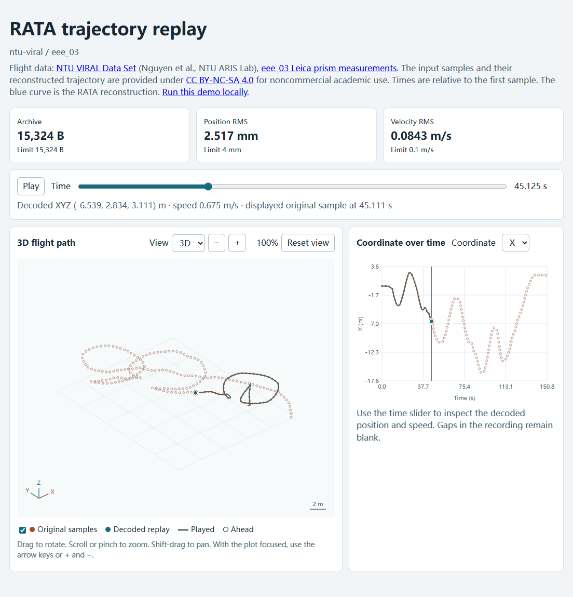

# Replay-Aware Trajectory Archiving

The demos encode one flight and generate an offline replay page. `rata` offers full samples, time-uniform subsets, and curves. `point` offers the two point representations. The executable uses the paper's archive format, replay reference, and local error checks. This entry searches one absolute byte cap and applies both requested RMS limits during the search and after decoding.

## Source code availability

The prepublication distribution provides executables for Windows x64 and Ubuntu 22.04 x86-64, dataset download scripts, and replay demos. The encoder and decoder source code will be made available in this repository upon formal publication of the article.

## Setup

Open [Release v0.1.0](https://github.com/ghghgh0001/Replay-Aware-Trajectory-Compression/releases/tag/v0.1.0). Under **Assets**, download [github-repository.zip](https://github.com/ghghgh0001/Replay-Aware-Trajectory-Compression/releases/download/v0.1.0/github-repository.zip) and the runtime for your platform. The helper ZIP contains the scripts and viewer template. Both packages must be extracted into the same folder, with `demo.py` next to the `runtime/` and `assets/` directories.

| Platform | Release asset | Executable |
| --- | --- | --- |
| Windows x64 | `rata-engine-windows-x64.zip` | `runtime/rata-engine.exe` |
| Ubuntu 22.04 x86-64 | `rata-engine-ubuntu-22.04-x86_64.tar.gz` | `runtime/rata-engine` |

Use Python 3.11 or later on Windows. The default Python 3.10 on Ubuntu 22.04 is also supported. The executable bundles its own runtime dependencies. The commands below install only the dependencies for the helper scripts.

**Windows x64.** Open PowerShell in the folder holding the downloaded ZIP files.

```powershell
Expand-Archive github-repository.zip -DestinationPath run
Expand-Archive rata-engine-windows-x64.zip -DestinationPath run
Set-Location run
python -m venv .venv
.\.venv\Scripts\Activate.ps1
python -m pip install -r requirements.txt
.\runtime\rata-engine.exe --help
```

If PowerShell blocks activation, use `.\.venv\Scripts\python.exe` in place of `python` for the remaining commands.

**Ubuntu 22.04 x86-64.** Open a terminal in the download folder. If needed, install `python3-venv` and `unzip` using the Ubuntu package manager.

```bash
mkdir run
unzip github-repository.zip -d run
tar -xzf rata-engine-ubuntu-22.04-x86_64.tar.gz -C run
cd run
python3 -m venv .venv
. .venv/bin/activate
python -m pip install -r requirements.txt
./runtime/rata-engine --help
```

To verify the downloads, compare their SHA-256 digests with [SHA256SUMS.txt](https://github.com/ghghgh0001/Replay-Aware-Trajectory-Compression/releases/download/v0.1.0/SHA256SUMS.txt). Use `Get-FileHash -Algorithm SHA256` in PowerShell or `sha256sum` on Ubuntu.

### Download the demo flight

```powershell
python datasets.py list
python datasets.py download ratm 12p
```

The download writes `data/ratm/12p.csv`, with timestamps in seconds and coordinates in meters.

The download script retrieves the original trajectory from its provider and checks the SHA-256 against the paper manifest before writing a local `t,x,y,z` CSV. The catalog includes 30 RATM flights, two NeuroBEM Vicon records, and 16 NTU VIRAL Leica prism records. Timestamp differences are converted to seconds, and positions are in meters. If an upstream server or proxy does not support ZIP range requests, obtain the specified source member from the provider and pass it to `datasets.py download ... --local-original PATH`.

- [RATM v3.0.0](https://github.com/tii-racing/drone-racing-dataset/releases/tag/v3.0.0)
- [NeuroBEM Vicon source](https://download.ifi.uzh.ch/rpg/NeuroBEM/)
- [NTU VIRAL Leica prism CSVs](https://github.com/ntu-aris/ntuviral_gt)

## Run the two demos

```powershell
python demo.py rata --dataset ratm --trajectory 12p --max-bytes 10042 --position-rms-mm 4 --speed-rms-mps 0.1 --output demo-rata
python demo.py point --dataset ratm --trajectory 12p --max-bytes 10042 --position-rms-mm 4 --speed-rms-mps 0.1 --output demo-point
```

### Choose another flight from the paper

You can run any of the 48 listed flights by changing command-line arguments. Run `python datasets.py list` to see the exact IDs grouped by dataset. The dataset keys are `ratm` (30 flights), `neurobem` (two flights), and `ntu-viral` (16 flights).

For example, to switch from RATM `12p` to NTU VIRAL `eee_03`, change `--dataset` to `ntu-viral`, `--trajectory` to `eee_03`, and pick a new output directory.

```bash
python datasets.py download ntu-viral eee_03
```

The demo downloads the flight automatically when the local input is absent. Set `--max-bytes`, `--position-rms-mm`, and `--speed-rms-mps` for the selected flight and use a fresh `--output` directory on each run. The cap is an absolute byte count. The paper's supplementary record table gives a reference cap for each flight. The demo applies the requested position and velocity limits to the finished file, so a tight cap or strict limits may yield no qualifying archive.

To try your own flight, replace `--dataset ... --trajectory ...` with `--input your-flight.csv`. The CSV must have the header `t,x,y,z`, strictly increasing timestamps in seconds, and finite Cartesian coordinates in meters.

### Read the results

By default each successful run writes `archive.rata`, `result.json`, and `replay.html`. The comparison page shows original sample markers from the input and a separate curve sampled from the decoder. Drag to rotate the 3D path, scroll or pinch to zoom, and shift-drag to pan. Use **Reset view** to return to the initial framing. The time slider and playback button update both plots. Samples ahead of the cursor appear as unconnected hollow markers. Played samples are filled, and the solid replay curve extends up to the cursor. Reported RMS values come from continuous scoring against the quintic reference built from the original samples. The option `--speed-rms-mps` bounds the RMS norm of the **velocity vector error**. Archive bytes include the full container and all decoding information.

The commands above use a 10,042-byte cap, twice the paper's 5,021-byte reference cap for RATM flight 12p. Open `demo-rata/replay.html` and `demo-point/replay.html` in a browser.

If no file qualifies, the command exits with code `2` and records the solver outcome in `result.json`. Status `0` denotes completion of the arithmetic graph search, `1` a solver limit, and `2` proof of infeasibility within that arithmetic graph or an insufficient cap for its fixed overhead. The final archive also passes the decoded byte, RMS, and local checks. Encoding builds candidates from the input and can take several minutes on long or fragmented records.

## Verify encoding, decoding, and error independently

1. Run one of the encoding examples above. Open `demo-rata/replay.html` to see the overlay, and keep `demo-rata/archive.rata` for decoding. The optional `--encode-only` flag skips the overlay.
2. Copy **only** `archive.rata` to a new folder in File Explorer or to another machine. You can keep the original CSV and encoding report wherever you prefer. For the example below, put the copy at `demo-transfer/flight.rata`. The decoder reads only the archive for flight data.

```powershell
python demo.py decode --archive demo-transfer/flight.rata --output decoded-flight
```

The generated `decoded-flight/decoded.csv` has the original `t,x,y,z` format with one reconstructed position for each stored original sample time. You can also open `decoded-flight/replay.html` to view the reconstructed flight between samples. The same decode command handles archives from either encoding mode.

3. To measure the reconstruction error yourself, supply the actual path of the original CSV and the decoded CSV. This command uses only those two files and runs without the engine.

```powershell
python demo.py compare --input data/ratm/12p.csv --decoded decoded-flight/decoded.csv --output compared-flight
```

If you moved the original CSV, replace the `--input` path with its current location.

The comparison requires matching sample counts and timestamps within 10 nanoseconds. It reports the position root-mean-square error and maximum three-dimensional position error over those samples, plus the maximum timestamp difference, in `compared-flight/comparison.json`. The encoding report separately measures replay between samples, using position and velocity against the paper's continuous reference.

## Query specific times

Create `times.csv` with header `t` and one query time in seconds per row, relative to the first input sample.

```csv
t
0.01
50
100
149
```

```powershell
runtime\rata-engine.exe query demo-rata\archive.rata times.csv decoded.csv
```

On Ubuntu, run `./runtime/rata-engine query demo-rata/archive.rata times.csv decoded.csv`.

This returns `t,x,y,z,vx,vy,vz`. If the requested batch includes a time outside continuous support, the command exits with an error before writing the output CSV.

The online replay shows the figure-eight RATM flight 12p used in the paper. It uses the paper’s 5,011-byte RATA archive at the reference budget. The original samples come from the [RATM dataset, v3.0.0](https://github.com/tii-racing/drone-racing-dataset/releases/tag/v3.0.0) (CC BY 4.0).

[](https://ghghgh0001.github.io/Replay-Aware-Trajectory-Compression/)
